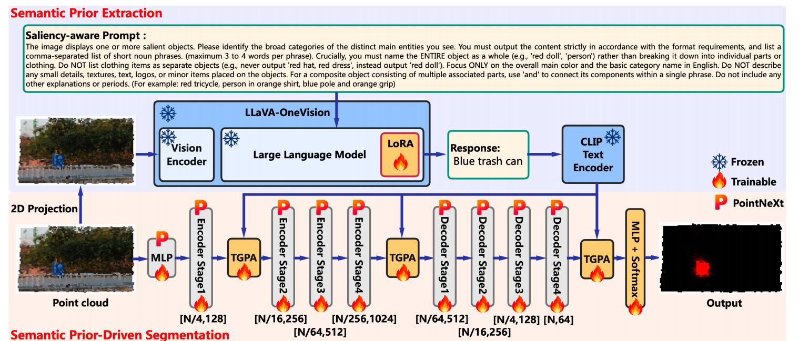
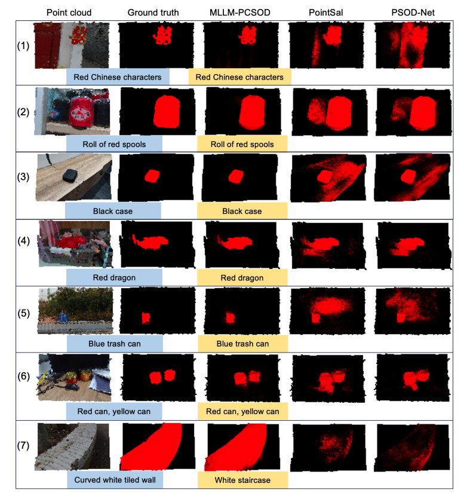

<div align="center">

# MLLM-PCSOD: A Semantic Prior-Driven Framework for Point Cloud Salient Object Detection via Multimodal Large Language Model


</div>

---

## Abstract

Existing point cloud salient object detection methods all follow a purely data-driven paradigm, relying solely on local geometric and color features for bottom-up saliency inference. Lacking high-level semantic understanding, they commonly suffer  from  background  false  activation  and  object  omission  in complex  backgrounds,  for  small  objects,  and  in  low-contrast scenarios.  To  fundamentally  break  this  limitation,  we  propose a novel semantic prior-driven paradigm and design the MLLM-PCSOD model based on it, adopting a top-down strategy of “semantic understanding first, then geometric segmentation”. Specifically,  a  multimodal  large  language  model,  LLaVA-OneVision, is  efficiently  fine-tuned  with  saliency-aware  prompts  and  2D point  cloud  projection  to  parse  scene  semantics  and  output salient object category text; the corresponding text features then guide a PointNeXt-based structure to detect saliency through a lightweight text-guided point-wise  attention module  and three-stage cross-modal alignment mechanism. Comprehensive experiments  show  that  MLLM-PCSOD  outperforms  all  representative  methods  on  F-measure,  E-measure,  and  intersection  over union, validating the effectiveness of the semantic prior-driven paradigm and showing that saliency detection performance can be markedly improved at a negligible cross-modal alignment cost.

## Highlights

- We propose for the first time a novel semantic prior-driven paradigm for PCSOD task, which breaks through the fundamental limitation of existing purely data-driven paradigms through a top-down strategy of “semantic understanding first, then geometric segmentation.” Based on this paradigm, we design the MLLM-PCSOD model, offering a promising research direction for this field.
- We design a dedicated saliency-aware prompt and instruction-tune a MLLM to output the categories of salient objects as text, providing MLLM-derived high-level semantic priors for PCSOD task.
- We propose highly lightweight TGPA modules (only 0.097M trainable parameters in total) and a three-stage cross-modal alignment mechanism to inject textual semantic priors into saliency prediction.
- Extensive experiments demonstrate the clear advantages of the proposed paradigm and model and reveal that PCSOD performance can be markedly improved at negligible cross-modal alignment cost.

## Method



MLLM-PCSOD consists of two branches:
1. **Semantic prior extraction branch：** It (top) employs a LoRA-fine-tuned LLaVA-OneVision and a frozen CLIP text encoder to produce saliency-related text features from the 2D point cloud projection.
2. **Semantic prior-driven segmentation branch：** It (bottom) builds a PointNeXt-based network and injects the saliency-related text features at three key positions via the TGPA modules to predict saliency.

## Results

### Quantitative Comparison on the PCSOD Dataset

| Method | MAE ↓ | F-measure ↑ | E-measure ↑ | IoU ↑ |
|---|---:|---:|---:|---:|
| PointSal  | 0.069 | 0.769 | 0.851 | 0.656 |
| PSOD-Net  | 0.058 | 0.805 | 0.878 | 0.711 |
| SFN  | 0.057 | 0.812 | 0.888 | 0.713 |
| MSV-PCT  | 0.052 | 0.845 | 0.908 | 0.763 |
| GeoEdgeFormer  | 0.050 | 0.827 | 0.891 | 0.732 |
| EGTNet  | 0.049 | 0.840 | 0.905 | 0.760 |
| EPFNet  | **0.047** | 0.820 | 0.898 | 0.727 |
| **MLLM-PCSOD** | 0.051 | **0.879** | **0.924** | **0.779** |

### Visual Comparison



**Figure 2.** Qualitative comparison of MLLM-PCSOD with PointSal and PSOD-Net. In each row, the blue and yellow text boxes present the human-annotated and LLaVA-predicted descriptions of the salient objects, respectively.

## Dataset

You can download the PCSOD dataset from [OpenI](https://openi.pcl.ac.cn/OpenPointCloud/PCSOD) and place it in the following directory:

## Code

训练、测试代码和预训练模型将在整理完成后发布。

```text
VLM3DSOD\
├── data\
│   ├── train\
│   └── test\
├── log\
|   ├── pcsod_textguided\
|       ├── logs\
|       └── checkpoints\
|           └── best_model.pth
├── models/
├── train.py
├── test.py
├── requirements.txt
└── ...

```

## Running

### Training

```bash
python train.py
```

### Testing

```bash
python test.py
```


## Citation

如果本工作对您的研究有所帮助，请引用：

```bibtex
```

## Acknowledgement

Our codes are built upon [PointNeXt](https://github.com/guochengqian/PointNeXt) and [PCSOD](https://openi.pcl.ac.cn/OpenPointCloud/PCSOD).

